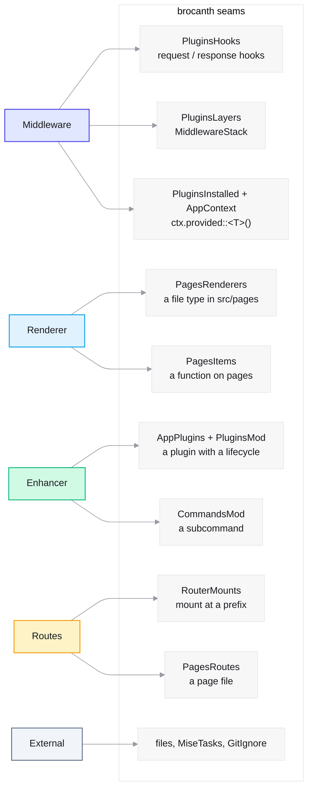
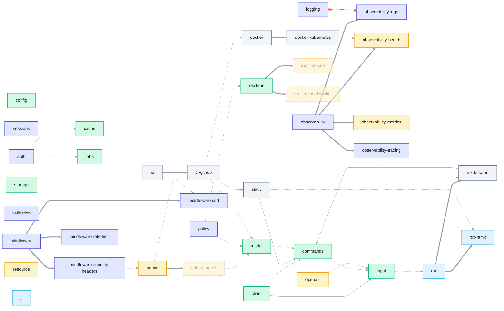

# Module map

Every module `brocanth create` offers (38), grouped into five categories,
with its dependencies. The data comes from the manifests and from the
slots each module writes (checked against `b3a3461` + `a0df519`).

## The five categories, and how each one hooks in

| Category | What it does | How it hooks into brocanth |
|---|---|---|
| **Middleware** | Runs around a request, and may enrich the context | `plugin_hooking` → `Slot::PluginsHooks` (request/response hooks); a layer → `Slot::PluginsLayers` + `AppSetup` mount; a context item → `Slot::PluginsInstalled` + `AppContext` (`ctx.provided::<T>()`); `plugins::wrap` (observability) |
| **Renderer** | Makes a response body: a file type in the page router, or a function | `Slot::PagesRenderers` (a `load_dir!` over `src/pages`); `Slot::PagesItems` (a function on `pages`) |
| **External** | Does not touch the code: build, ship, check | Files only (`Dockerfile`, `ci.yml`); `MiseTasks`, `GitIgnore`, `NodeDependencies` |
| **Enhancer** | Adds a capability to the codebase | A plugin with a lifecycle → `AppPlugins` + `PluginsMod`; a subcommand → `CommandsMod`; settings → `ConfigSections` |
| **Routes** | Answers at a path the application chooses | `Slot::RouterMounts` (`mount(routes, "/prefix")`); `Slot::PagesRoutes` (a page file in `src/pages`) |

## The table

**Bold** is the main category. *Needs* is a hard requirement (the flags
refuse without it). *Optional* means the module writes different code
when the other one is present (`after` or `project.has`). ★ means the
module also writes two shapes depending on `config`: a section read from
the file, or a literal in code.

| Module | Categories | Seams it writes | Part of | Needs | Optional |
|---|---|---|---|---|---|
| `logging` | **Middleware** | Layers, AppSetup, AppPlugins ★ | | | refused with `observability-logs` |
| `observability` | **Middleware**, Enhancer, Routes | AppPlugins, `plugins::wrap` ★ | | | children below |
| `observability-logs` | **Middleware** | (parent's plugin) | observability | | |
| `observability-health` | **Routes** | `/up`, `/readyz` via the observer, not RouterMounts | observability | | |
| `observability-metrics` | **Routes** | `/metrics`, on a side listener | observability | | |
| `observability-tracing` | **Middleware** | (parent's plugin) | observability (off) | | |
| `config` | **Enhancer** | Cargo dep, `config/<env>.toml` | | | used by 13 modules ★ |
| `sessions` | **Middleware** | Layers, AppContext ★ | | | |
| `model` | **Enhancer**, Middleware | AppContext, CommandsMod (`migrate`) ★ | | | `commands` |
| `cache` | **Enhancer** | AppPlugins ★ | | | |
| `jobs` | **Enhancer** | AppPlugins (worker) ★ | | | |
| `auth` | **Middleware**, Enhancer | AppContext ★ | | | `jobs`, `cache` (→ PgStore) |
| `policy` | **Middleware** | AppContext ★ | | | `model`, `realtime` |
| `storage` | **Enhancer**, Middleware | AppContext, GitIgnore ★ | | | |
| `validation` | **Middleware** | AppContext ★ | | | |
| `realtime` | **Enhancer**, Middleware | AppContext ★ | | | |
| `realtime-sse` | Routes | blocked | realtime | | |
| `realtime-websocket` | Routes | blocked | realtime | | |
| `input` | **Enhancer**, Renderer | PagesItems (`describe`) | | | `rsx` |
| `client` | **Enhancer** | CommandsMod (`api`) | | `input`, `commands` | |
| `middleware` | **Middleware** | AppPlugins (5 hooks, commented) | | | |
| `middleware-csrf` | **Middleware** | PluginsHooks | middleware | | |
| `middleware-security-headers` | **Middleware** | PluginsHooks | middleware | | `admin` (CSP hash) |
| `middleware-rate-limit` | **Middleware** | PluginsHooks | middleware (off) | | |
| `openapi` | **Routes**, Enhancer | PagesRoutes (`/openapi.json`, `.yaml`) ★ | | | `input` |
| `resource` | **Routes** | RouterMounts (`/api`) | | | |
| `admin` | **Routes** | RouterMounts (`/admin`), PagesRoutes | | | `middleware-csrf` (stamped forms) |
| `admin-model` | Routes | blocked | admin | `model` | |
| `commands` | **Enhancer** | CommandsMod (`routes`) | | | `input` |
| `rsx` | **Renderer** | PagesRenderers (`.rsx`), assets | | | children below |
| `rsx-tailwind` | **External**, Enhancer | CommandsMod (`css`), MiseTasks, package.json | rsx | `commands` | |
| `rsx-htmx` | **Renderer** | `html!` depth, `public/dpswap.min.js` | rsx | | |
| `jt` | **Renderer** | PagesRenderers (`.jt`), an example page | | | |
| `static` | **External**, Enhancer | CommandsMod (`export`), MiseTasks | | `commands` | `rsx-tailwind`, `rsx-htmx` (assets) |
| `docker` | **External** | Dockerfile | | | |
| `docker-kubernetes` | **External** | `deploy/kubernetes.yaml` | docker (off) | `observability-health` | |
| `ci` | **External** | (nothing) | | | |
| `ci-github` | **External** | `.github/workflows/ci.yml` | ci | | `docker`, `static`, `model`/`jobs`/`cache` |

## The dependency tree

Thick arrow: part of. Solid: needs. Dashed: optional. Red: refused
together. Colour: main category. `config` is left out of the graph: 13
modules adapt to it (★).

Colours are d3set's light series palette (`src/theme/theme.ts`):
middleware `#4f46e5`, renderer `#0ea5e9`, enhancer `#10b981`, routes
`#f59e0b`, external `#64748b`. Edges route at right angles with rounded
corners (`curve: rounded`, Mermaid 11.13 and later; an older renderer
falls back to smooth curves).

`logging x-.-x observability-logs`: the two are refused together.
`static` refuses every module that is not outside the runtime; that rule
is not drawn.

## What the map shows

1. ~~**The category is implicit.**~~ Closed: every manifest declares
   `category(..)`, and a test holds it to the slots it writes
   (`Slot::open_to`). Two readings changed against the table above: `jt`
   is also Routes (it writes an example page), and every module that puts
   a value on the context is also Middleware.
2. ~~**Optional dependencies are not declared.**~~ Closed: every
   `project.has` is an `adapts_to(key, what_changes)` in the manifest, 36
   in all (13 of them `config`, through `snippet::configurable`). A test
   fails on an undeclared one.
3. **`config` is cross-cutting.** 13 modules write two shapes, one with
   it and one without. It behaves like a shared dependency, not a module
   on equal footing.
4. **Routes do not share one seam.** `admin` and `resource` use
   `RouterMounts`; `openapi` writes page files; `/up`, `/readyz` and
   `/metrics` are answered by the observer before the router. The
   application chooses the prefix only for the first kind.
5. **Some modules sit in two categories.** `observability` wraps
   requests, owns probe routes and drives shutdown. `rsx-tailwind` is a
   node build (external) that also adds a command. `static` is an output
   mode (external) that adds a command. `model`, `auth`, `storage` and
   `realtime` are services that also put an item on the context.
